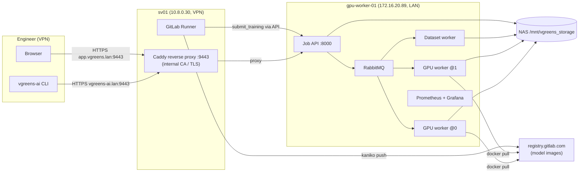
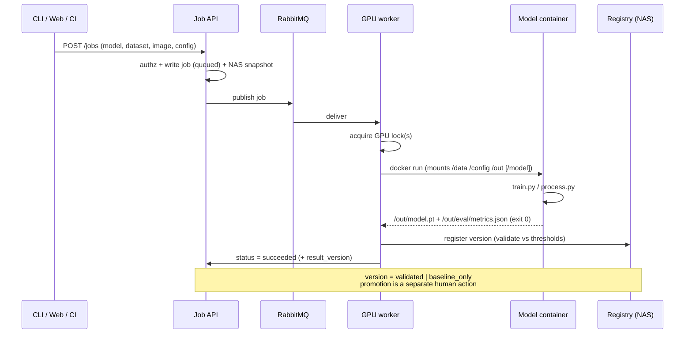
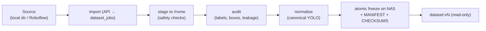
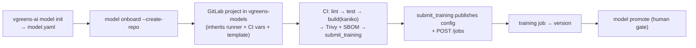

# vGreens AI Platform — Architecture

**An internal, self-hosted MLOps platform for training and serving computer-vision
models on the company's own GPU hardware.** It turns a bare GPU server into a
governed service: datasets are frozen and versioned, models are onboarded from a
declarative spec, training and inference run as queued jobs in isolated
containers, and every model version is validated against thresholds before it can
be promoted to "active". Engineers drive it from a CLI or a web UI; nobody SSHes
to the GPU box to run training by hand.

---

## 1. Goals and constraints

**Goals**
- One reproducible path to onboard a new model: spec → repository → CI image →
  training job → validated version → promotion.
- Datasets are immutable, versioned, and audited before use.
- Training/inference are isolated, observable, and resource-governed (per-GPU).
- A single control plane (the Job API) that the CLI, web UI, and CI all use.

**Constraints (deliberate design boundaries)**
- The **API is the only control plane**. CI never SSHes to the GPU host, never
  calls Docker there, and never touches the queue directly — it only calls the API.
- **Human gates** remain manual: dataset licence approval, production promotion,
  and two-GPU training.
- No Kubernetes, no cloud GPUs — everything runs on the existing on-prem hardware.
- Secrets (tokens, NAS credentials, vault values, registry credentials) never live
  in code or logs.

---

## 2. Hosts and network topology

| Host | Address | Role |
|------|---------|------|
| **gpu-worker-01** | `172.16.20.89` (LAN), 2× GPU, Ubuntu 24.04 | Job API, RabbitMQ, GPU + dataset workers, model containers, Prometheus/Grafana, NAS mount |
| **sv01** | `10.8.0.30` (VPN) / public NIC, Ubuntu 22.04 | GitLab Runner (CI), Caddy reverse proxy; also hosts an unrelated livestream nginx |
| **NAS** | mounted at `/mnt/vgreens_storage` on gpu-worker-01 | dataset registry, model registry, job outputs, config store, DB backups |

The GPU host sits on the office LAN with **no public exposure**. Remote users reach
the platform over the company **VPN**, but the VPN only routes the `10.8.0.0/24`
subnet — not the office LAN — so **sv01 is the entry point**: it is VPN-reachable
and can reach the GPU host, so the reverse proxy runs there.



---

## 3. Core components

**Job API (FastAPI, `vgreens-ai-api` systemd unit, port 8000).** The single control
plane. Accepts job submissions, tracks job/worker/GPU state, serves the model
registry, enforces authentication + RBAC, and records an audit trail. State lives
in a local **SQLite `jobs.db`** on the GPU host's disk (never on the NAS), evolved
through tracked migrations. It publishes jobs to RabbitMQ and exposes Prometheus
metrics at `/metrics` and health at `/health*`.

**Message broker (RabbitMQ).** Durable queues decouple submission from execution:
`training_jobs`, `processing_jobs`, `dataset_jobs`, and `failed_jobs`
(dead-letter). Messages carry no secrets.

**Workers (systemd).** `vgreens-worker@0` and `@1` are GPU workers (one per GPU);
`vgreens-dataset-worker` is a CPU worker for the Dataset Factory. Workers consume
from the queue, acquire the resource locks they need, launch the job's container,
watch it, and report status back to the API. `mount-nas` ensures the NAS is
mounted before workers/API start.

**Model containers (Docker).** Each model ships as an immutable image honouring a
fixed **container contract** (§5). The worker runs it with the dataset, config,
and output directories bind-mounted, and the right GPUs attached.

**Registry + storage (NAS).** Immutable frozen datasets, promoted model versions,
per-job outputs, the job-config store, and nightly DB backups all live under
`/mnt/vgreens_storage/ai/`.

**Monitoring (Prometheus + Grafana).** Scrapes the API and node/GPU exporters;
alert rules cover worker-stopped, queue backlog, and job failures.

**Reverse proxy (Caddy on sv01).** Terminates HTTPS with an internal CA and fronts
two hostnames on `:9443`: `vgreens-ai.lan` → the API (for the CLI), and
`app.vgreens.lan` → the web UI (serving the SPA and proxying `/api` to the API on
the same origin). Bound to the VPN interface only.

**Clients.** The **CLI** (`vgreens-ai`, a thin HTTP client with profiles) and the
**web app** (React/Vite SPA) both talk only to the Job API.

---

## 4. Job lifecycle



Training produces a new **model version**; the registry validates its
`metrics.json` against the thresholds in the job config. If it clears them the
version is **`validated`** (promotable); otherwise **`baseline_only`**. Promotion
to "active" is an explicit, audited command (`model promote`) — never automatic.
Processing/inference jobs serve the currently **active** promoted model.

---

## 5. The container contract

Every model image — whichever framework — obeys the same contract, which is what
lets the platform treat models uniformly:

- **Mounts:** `/data` (read-only dataset), `/config/job.yaml` (read-only),
  `/out` (writable), `/model` (read-only, processing only).
- **Environment:** `JOB_ID`, `JOB_TYPE`, `MODEL_NAME`, `MODEL_VERSION`,
  `DATASET_VERSION`, `TENANT`, `GPU_COUNT`.
- **Outputs:** training writes `/out/model.pt` + `/out/eval/metrics.json`;
  processing writes `/out/report.json`.
- **Exit 0** on success; non-zero fails the job.

An `entrypoint.py` dispatches on `JOB_TYPE` to `train.py` or `process.py`.

---

## 6. Dataset Factory

Raw data becomes an immutable, audited, versioned dataset before any model may use
it.



Adapters bring data in from a **local/NAS path** (allowlisted roots) or **Roboflow**
(server-side API key, redacted in logs). Safety checks reject path traversal,
symlinks, zip bombs, and oversized inputs. The audit classifies issues as fail /
warn / allow (e.g. corrupt images or invalid labels fail; out-of-bounds boxes warn
and are cleaned). Normalisation produces a canonical YOLO layout; the freeze is
**atomic** (temp dir → `os.replace` → `.complete` marker → read-only), with a
`MANIFEST.json` and `CHECKSUMS.sha256`. Versions are allocated atomically
(reserve-then-finalize), so a frozen `dataset:vN` never changes.

---

## 7. Model onboarding (the golden path)



A model is declared in a **`model.yaml`** (schema-validated): name, task, preset,
dataset, training params, thresholds, repository. `model init` writes it
interactively; the **generator** turns it into a complete repo (contract-compliant
`train.py`/`process.py`, a headless Dockerfile, CI config, tests). Presets
(`ultralytics_detection/classification/segmentation`) emit working YOLO code;
`custom_python` emits a **runnable reference** the engineer edits. `onboard
--create-repo` creates the GitLab project **inside the `vgreens-models` group** so
it automatically inherits the CI runner, CI/CD variables, and the shared CI
template, then pushes it — the first pipeline runs on its own.

CI (shared `model-ci.yml`) runs on the self-hosted runner: lint, test, **kaniko**
build (unprivileged — no Docker daemon on the shared host), **Trivy** scan +
**Syft** SBOM (advisory), and a manual **`submit_training`** that publishes the job
config and calls the Job API. CI never trains or touches the GPU directly.

---

## 8. Security model

- **Authentication:** username/password (bcrypt) with HttpOnly session cookies
  (`vg_session`); plus API tokens — a static bootstrap admin token and DB-issued
  operator tokens (raw shown once, stored hashed).
- **Authorisation (RBAC):** `viewer` < `operator` < `admin`. Reads are viewer;
  submitting/cancelling jobs and publishing configs are operator; user/token
  management and promotion/rollback are admin.
- **Network:** the API binds locally; only Caddy is exposed, over TLS, bound to the
  VPN interface. The GPU host has no public surface.
- **CI boundary:** CI authenticates to the API with a scoped operator token and can
  only *submit* work; it cannot reach the GPU host, Docker, or the queue.
- **Secrets:** Ansible Vault for infra secrets; GitLab group CI/CD variables
  (masked) for CI; a group deploy token (read-registry) for image pulls; Roboflow
  key server-side and redacted. Nothing secret is written to code, `.env` dumps, or
  logs.
- **Integrity:** production SQLite schema changes only via migrations; `jobs.db`
  stays on local disk; nightly verified backups to the NAS.

---

## 9. Infrastructure as code

- **`vgreens-ai-platform`** — API, workers, CLI, model generator, web app,
  systemd units, deploy scripts.
- **`vgreens-model-template`** — the shared CI template every model repo includes.
- **`vgreens-model-*`** — generated per-model repos (under the `vgreens-models`
  group).
- **`vgreens-ai-infra`** — Ansible: roles for the constrained **GitLab Runner**,
  the **Caddy** reverse proxy, and the **apt mirror** fix; inventory reaches the GPU
  host via an SSH `ProxyJump` through sv01; secrets in Vault.

Deployment is systemd on the GPU host (`vgreens-ai-api`, `vgreens-worker@`,
`vgreens-dataset-worker`, `mount-nas`, `vgreens-db-backup.timer`) and Ansible-managed
services on sv01.

---

## 10. Storage layout (NAS)

```
/mnt/vgreens_storage/ai/
├── datasets/<name>/<vN>/     frozen, read-only datasets (+ MANIFEST, CHECKSUMS)
├── models/                   promoted model versions + active pointer
├── jobs/<year>/<job_id>/     per-job snapshot + outputs + logs
├── job-configs/<model>.yaml  published training configs
├── incoming/                 raw import staging area (pre-freeze)
└── backups/                  nightly jobs.db.<stamp>.gz (verified)
```

Local NVMe on the GPU host holds `/nvme/dataset-staging` (import staging) and an
LRU cache of staged datasets for training.

---

## 11. Summary

The platform is a small number of well-separated pieces — an API control plane, a
queue, containerised workers, an immutable registry on the NAS, and a reverse proxy
— tied together by two contracts (the **container contract** for models and the
**job/registry lifecycle** for versions). Everything an engineer does goes through
the API, every dataset and model version is immutable and audited, and the risky
actions (licence approval, promotion, multi-GPU) stay behind human gates. New
models join through one declarative spec and a single command, and the whole
system is reproducible from the four Git repositories.
```
